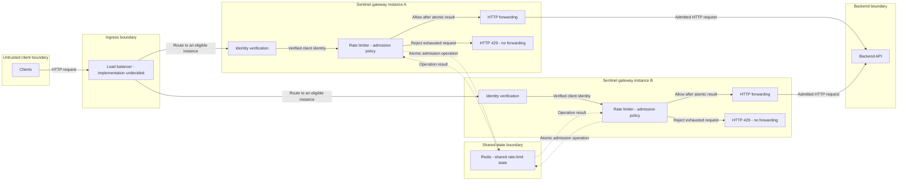

# Sentinel — Proposed High-Level Architecture

Date: 2026-10-26
Ticket: SENT-002 — High-Level System Architecture
Status: PROPOSED — awaiting project-owner review and approval

## 1. Overview, goals, and evidence

Sentinel is a distributed rate limiter and API gateway. This proposal places multiple gateway instances behind a load balancer. Each gateway establishes a trusted client identity, evaluates rate-limit admission using shared Redis state, and forwards admitted HTTP requests to a backend API. Requests rejected for rate-limit exhaustion receive HTTP 429 without reaching the backend.

The goals are independent per-client limits, correct concurrent admission, shared enforcement across instances during normal operation, explicit trust boundaries, and understandable failure behavior. Learning and owner understanding take priority over implementation speed. This document describes intended structure, not running infrastructure.

| Classification | Basis and meaning |
| --- | --- |
| DOCUMENTED | [REQUIREMENTS.md](REQUIREMENTS.md) records the owner-approved requirements direction and the normal-operation versus Redis-unavailable clarification. |
| DOCUMENTED | DEC-001 and DEC-002 approve Java 21 and Spring Boot with Spring Cloud Gateway. DEC-003 approves Redis in principle; its implementation details remain open. DEC-004 through DEC-006 govern learning, context, and evidence-backed performance claims. See [DECISIONS.md](DECISIONS.md). |
| PROPOSED | The topology, logical component boundaries, interactions, and failure-handling responsibilities in this document await owner approval. No load-balancer product, authentication mechanism, or Redis-failure policy is selected. |
| VERIFIED | At the drafting inspection, the repository contained project documentation and no application code or build configuration. This is evidence of repository state, not architectural correctness. |
| UNKNOWN | Runtime correctness, latency, throughput, availability, recovery behavior, and deployment feasibility have not been established through implementation or execution. |

Creating this draft does not approve new architectural decisions, change DECISIONS.md, authorize implementation, or close SENT-002.

## 2. Proposed normal-operation diagram

The diagram shows the normal admission path with Redis available. Gateway boxes represent independently running Sentinel instances; identity verification, rate limiting, and forwarding inside each box are logical components of that instance, not separately selected services. Two instances illustrate shared enforcement; the diagram does not set a deployment count or load-balancer implementation.

Solid arrows show HTTP/request processing; dotted arrows show Redis state operations and their results, not HTTP proxying. Redis has no forwarding edge to the backend. Each limiter must obtain the normal-operation atomic result before taking its allow or exhausted-reject path. Backend responses and gateway-generated rejections return through the ingress connection; return edges, identity-error responses, health probes, and outage-policy paths are omitted for readability and discussed below.

## 3. Normal request flow

This flow assumes Redis is available, the applicable limit and time semantics have been configured consistently, and a valid client identity can be established. These are design preconditions, not verified runtime facts.

1. A client sends an HTTP request to the load balancer. The load balancer selects an eligible Sentinel instance according to an as-yet-undecided routing and health-check configuration.
2. The selected gateway verifies the evidence used for client identity and derives the identity used for rate-limit accounting. A claimed identity is not accepted merely because it appears in a header. Handling missing or invalid evidence remains an open decision and must not silently treat an unverified identity as trusted.
3. The rate-limiting component resolves the applicable admission policy and asks Redis to execute the required atomic state operation for that client and limit scope. The chosen algorithm, key structure, time semantics, and configuration mechanism remain undecided.
4. The operation evaluates the available allowance and conditionally consumes it as one atomic decision. Redis may execute this admission computation; the rate limiter owns the policy, supplies the operation's agreed inputs, and enforces its result.
5. **Allow:** with allowance consumed by the admission operation, the gateway invokes its HTTP forwarding component. The request reaches the configured backend API, and the response returns through the gateway and load balancer. Backend success or error response status does not refund the consumed allowance (FR-004).
6. **Reject for exhaustion:** the gateway returns HTTP 429 without invoking backend forwarding (FR-003). The exhausted request consumes no additional allowance (FR-005). Rejection metrics may still be recorded.

Concurrent requests from different gateways follow the same shared accounting rules. Allowance accounting and backend execution are not one transaction. Rules for ambiguous Redis outcomes, transport failures after admission, or retries require further decisions; this proposal promises neither exactly-once forwarding nor automatic refunds.

## 4. Component responsibilities and boundaries

All boundaries in this table are PROPOSED and subject to review.

| Component | Responsibility | Boundary |
| --- | --- | --- |
| Clients | Send requests and any identity evidence required by the eventual trust model. | Client-controlled headers and claims are untrusted input. A client does not choose its authoritative accounting identity. |
| Load balancer | Distribute incoming HTTP requests among eligible gateway instances and evaluate gateway health according to a future configuration. | Does not own authoritative rate-limit counters or establish identity simply by forwarding a header. Product, routing strategy, health semantics, and deployment are undecided. |
| Identity-verification component | Establish a trusted client identity for admission, validating evidence under the eventual authentication or trusted-hop model. | Logical gateway responsibility; no identity provider, token format, or external authentication service has been selected. |
| Rate-limiting component | Own admission policy, resolve applicable limits, invoke shared atomic operations, enforce allow/reject results, and apply the configured Redis-failure policy. | Redis may execute atomic admission logic on its behalf; Redis is not an HTTP gateway or an independently chosen source of business policy. |
| Shared Redis state | Hold authoritative normal-operation rate-limit state and execute atomic operations needed by the selected algorithm. | Receives state operations, not proxied backend HTTP requests. Persistence, failover, eviction, expiration, and recovery guarantees are undecided. |
| HTTP forwarding component | Forward admitted requests to the configured backend and relay responses. | Must not be invoked for requests rejected by admission. Forwarding details and retry behavior remain open. |
| Backend API | Handle admitted application requests and return responses. | Gateway allowance is consumed before backend response status is known. The backend does not own Sentinel's shared admission counters. Preventing direct bypass of the gateway requires an approved access boundary. |

## 5. Trust boundaries

- **Client to ingress:** a client can forge or change identity-related headers. Blind trust would let a caller impersonate another client, evade its own limit, or exhaust someone else's allowance, violating FR-001 and FR-002.
- **Ingress to gateway identity verification:** traffic arriving through a load balancer is not automatically authenticated. If a trusted upstream later supplies identity, the design must define how that upstream is authenticated, how client-supplied claims are stripped or replaced, and how direct gateway access is controlled. Alternatively, identity evidence may be verified by the gateway. Neither approach is selected here.
- **Gateway to Redis:** only authorized rate-limiting operations should reach shared state. Connectivity, credentials, transport protection, command permissions, and configuration handling require explicit design. Being inside a deployment does not by itself establish trust.
- **Gateway to backend:** backend addressing and access controls must preserve the admission boundary. Whether and how the backend accepts only trusted gateway traffic remains open; arbitrary caller-controlled upstream destinations must not be assumed safe configuration.
- **Configuration boundary:** routes, limits, identity trust settings, and failure-policy settings affect security and correctness. Their source, validation, access controls, and update consistency remain unresolved.

TLS termination, trusted proxy metadata, identity-header handling, and authentication implementation are open choices. No particular load balancer, network layout, or authentication protocol is implied by the diagram.

## 6. Shared state, atomicity, and gateway statelessness

During normal operation with Redis available, all gateways must use the same logical state and compatible policy/configuration for a given client and limit scope. This supports FR-001, FR-006, FR-007, NFR-001, and NFR-002 without relying on a client always reaching the same instance.

The allowance check and conditional state update must be indivisible with respect to competing requests. Separately reading an allowance and later decrementing it without coordination can let multiple gateways observe the same remaining allowance and admit too many requests. The atomic operation must conditionally account for admission while leaving exhausted rejections without an additional allowance charge. Any required time or expiration updates must preserve the selected algorithm's semantics.

The rate limiter owns admission policy. Redis may execute atomic check-and-update logic and return its outcome; the gateway enforces that outcome by forwarding or rejecting. The implementation might use an appropriate Redis atomic mechanism, but this draft selects no script, command sequence, transaction, or algorithm.

Gateway instances are proposed to be stateless **with respect to authoritative rate-limit counters**. They may still hold configuration, connections, transient request state, and other non-authoritative data. Under normal-operation rules, a restarted or newly added gateway must use the existing shared state rather than initialize a fresh independent allowance for each client.

A gateway crash must not erase shared counters held in Redis. This is separation of state from gateway process lifetime, not a durability guarantee for Redis itself: expiration, eviction, Redis restart, or failover may affect state according to mechanisms that have not yet been designed. Local fallback counters, if later approved, would be a separate degraded mode and would not establish the strict normal-operation global guarantee.

## 7. Gateway-instance failures and health checks

The proposed load balancer checks gateway health and removes instances considered unhealthy from selection for new requests. Probe endpoints, intervals, thresholds, readiness/liveness semantics, and re-entry after recovery remain undecided. Health detection takes time; requests can still encounter an instance that fails before it is removed. No zero-downtime guarantee is made.

Other eligible gateway instances can use the same Redis state; loss of one gateway therefore must not reset the client's shared allowance. This does not guarantee spare capacity, an available alternative gateway, or successful load-balancer routing.

A crash can interrupt requests before admission, after allowance consumption, or after the backend has begun work. Clients may observe connection failures or ambiguous outcomes. There is no guaranteed recovery of in-flight requests. Transparent retries may repeat backend side effects or complicate allowance accounting; no automatic retry or refund policy is selected.

Health-check behavior during a shared Redis outage requires separate design. Marking every gateway unready may make the entire gateway tier unreachable even if a future configured policy would allow degraded service. Keeping a process healthy also does not prove that strict distributed admission is available. These trade-offs must be reviewed together with outage policy. The load balancer's own failure behavior and redundancy are not designed by this proposal.

## 8. Redis dependency and unresolved outage behavior

Redis is a dependency of the rate limiter, not an HTTP proxy. Under the requirements clarification, strict shared enforcement applies during normal operation when Redis is available. If Redis is unavailable, Sentinel follows its configured failure policy once that policy is designed and approved.

Fail-open and local fallback may weaken global enforcement guarantees. A policy that denies requests when shared state cannot be consulted has different availability trade-offs. None of these policies, defaults, or supported modes is selected here, and an outage is not automatically equivalent to rate-limit exhaustion or an HTTP 429 response.

Timeouts create ambiguous outcomes: an atomic operation may have consumed allowance even if its result did not reach the gateway. Blindly repeating the operation could consume allowance again. Detecting failure, handling uncertain outcomes, retry rules, response statuses, and recovering/reconciling state require explicit decisions. An atomic Redis operation alone does not solve cross-system retry or recovery semantics.

## 9. Limitations and open architectural questions

This is a logical proposal, not a deployment specification. It establishes no measured performance, availability objective, Redis durability, backend idempotency, production security, or recovery capability. There are no implementation or executed fault-test results supporting those properties yet.

| Open question | Why it matters |
| --- | --- |
| Which load balancer, routing strategy, health checks, and ingress deployment will be used? | Determines instance selection, detection behavior, and ingress failure exposure. |
| How will clients be authenticated or identified, and which upstream claims can be trusted? | Defines independent client accounting and protects against identity spoofing. |
| Which algorithm, time window/refill model, clock, burst behavior, and allowance rules will apply? | Defines what correct admission means under concurrency and at time boundaries. |
| How will limits and routes be configured, validated, and updated consistently? | Different gateway policies can violate intended shared enforcement even when counters are shared. |
| What Redis keys, expiration/eviction rules, atomic operations, deployment, and persistence/failover configuration are required? | Determines state isolation, correctness, and state-loss exposure. |
| What are the supported Redis-failure policies, defaults, timeouts, statuses, and recovery behavior? | Defines degraded-mode availability and any weakened global guarantees. |
| How will ambiguous state-operation outcomes, gateway crashes, retries, and backend side effects be handled? | Admission and backend processing are not an end-to-end atomic transaction. |
| Which compatible Spring Boot/Spring Cloud/Gateway versions and Gateway variant will be selected for Java 21? | Must be resolved before application initialization under DEC-002. No compatibility research or version selection occurred in this draft. |
| Where are transport protection, trusted-hop enforcement, backend access controls, and configuration secrets managed? | Turns the proposed trust boundaries into enforceable controls. |
| What HTTP forwarding cases and observability boundaries must be supported? | Defines testable proxy semantics, counts, rejection/error rates, and latency measurement. |

## 10. Review and next action

Review the proposed topology, component ownership, trust boundaries, and normal versus degraded operation with the project owner. Check alignment with FR-001 through FR-008, NFR-001 through NFR-008, and DEC-001 through DEC-006. Validate the Mermaid diagram in the owner's documentation viewer before treating its presentation as reviewed.

Document review is distinct from implemented verification or demonstrated proficiency. Architectural decisions must be approved separately before recording them in DECISIONS.md. SENT-002 remains In Progress until the project owner explicitly approves closure; no next ticket or phase transition is authorized by this draft.
